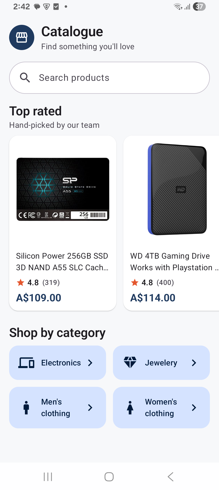
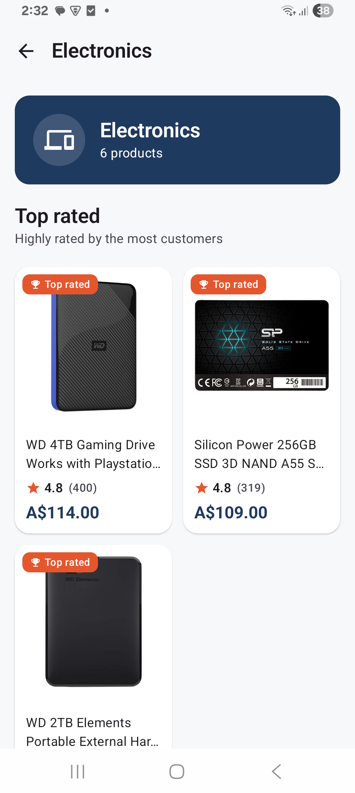
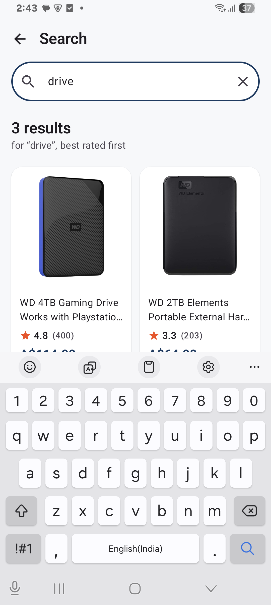
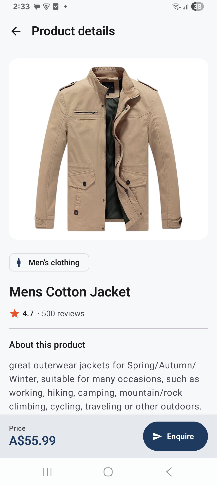
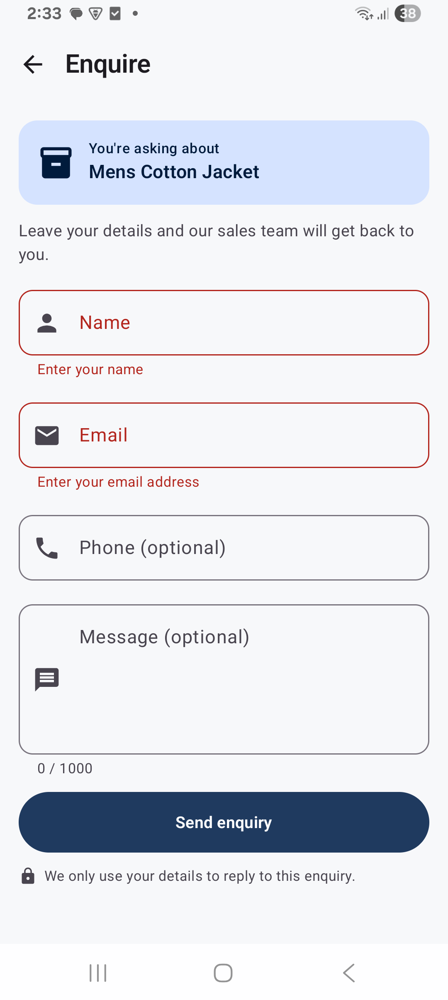
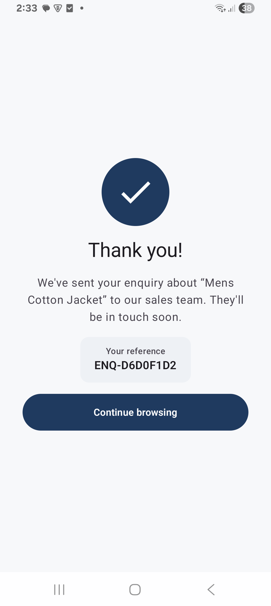

# Product Catalogue PoC

A product catalogue for an entrepreneur's MVP: an **Android app** and a **Node.js API**. Customers see hand-picked products, browse categories, search, open a product and send an enquiry, which emails the sales inbox.

<p>






</p>

## Stack and why

| Part | Choice | Why |
|---|---|---|
| **Client** | Android: Kotlin, Jetpack Compose, Hilt, Retrofit + OkHttp, coroutines/Flow, type-safe Navigation (`android-app/`) | My strongest platform (8 years), so the time went into architecture and quality, not learning a framework |
| **Backend** | Node.js + TypeScript: Fastify, Zod (`backend/`) | The brief's preferred backend. Structured logs, security plugins, fast in-process HTTP tests. Ships as a Docker image that runs on AWS (ECS/Fargate) as it is |
| **Product data** | Fake Store API, **only ever called by the backend** | Required by the brief, and it lets the data source change without an app release |
| **Email** | SMTP: **Mailpit** locally (an inbox in your browser), Amazon SES in production | Free, no accounts, and the same code path as production |

The design rule: everything the brief says will change (the data source, email provider and look and feel) sits behind an interface, chosen by configuration. Details are in [DECISIONS.md](DECISIONS.md).

---

## Run it locally

There are two steps: **start the backend**, then **run the app**. Choose **A** (Docker) or **B** (no Docker) for the backend.

### What to install

| Tool | Needed for | Check it's installed |
|---|---|---|
| [Git](https://git-scm.com/downloads) | Getting the code | `git --version` |
| [Docker Desktop](https://www.docker.com/products/docker-desktop/) | Option A | `docker --version`, and Docker Desktop says *Engine running* |
| [Node.js](https://nodejs.org) **22.9+** (LTS) | Option B, and the backend tests | `node --version` |
| [Android Studio](https://developer.android.com/studio) (latest stable) | The app. It includes Java (JDK) and the emulator | Opens; on first launch, accept the *Standard* setup |

```bash
git clone https://github.com/erpriyesh/ProductCatalogue.git
cd ProductCatalogue
```

### Step 1, option A: backend with Docker (recommended)

```bash
docker compose up --build
```

This starts the API **and** a Mailpit sales inbox. The first run takes a minute or two. Leave the terminal open; it shows the logs.

**Check:**
- http://localhost:3000/health shows `{"status":"ok"}`.
- **http://localhost:8025 is the sales inbox.**

**To stop,** press `Ctrl+C`, then run `docker compose down`.

### Step 1, option B: backend without Docker

There's no email server in this mode, so first create a `.env` file that prints emails to the terminal. From the project folder, run the line for your terminal:

| Terminal | Command |
|---|---|
| macOS / Linux / Git Bash | `sed 's/^EMAIL_TRANSPORT=smtp/EMAIL_TRANSPORT=log/' .env.example > .env` |
| Windows PowerShell | `(Get-Content .env.example) -replace '^EMAIL_TRANSPORT=smtp','EMAIL_TRANSPORT=log' \| Set-Content .env` |

Then start the backend:

```bash
cd backend
npm ci
npm run dev
```

**Check:** http://localhost:3000/health shows `{"status":"ok"}`. Enquiry emails are printed in this terminal. **To stop,** press `Ctrl+C`.

### Step 2: run the Android app (emulator)

1. In Android Studio, **File → Open** the **`android-app`** folder. Not the project root.
2. Wait for **Gradle sync** to finish (bottom status bar). The first sync downloads dependencies and takes a few minutes.
3. **Device Manager** (phone icon, right edge) **→ + → Create Virtual Device**: pick a Pixel and the newest system image.
4. Select the **`app`** configuration and your emulator, then press **Run ▶**.

**Check:** the Catalogue home screen shows products. The app calls the backend at `http://10.0.2.2:3000/`, which is the emulator's address for your computer, so there's nothing to configure. To test the connection by itself, open `http://10.0.2.2:3000/health` in the emulator's Chrome.

### Which backend address to set (emulator or real phone)

The app reads the backend address from **one line** in `android-app/gradle.properties`:

```properties
catalogue.apiBaseUrl=http://10.0.2.2:3000/
```

Set it for the device you run on, then press **Run ▶** again so the app is rebuilt with it:

| Running the app on | Set `catalogue.apiBaseUrl` to | Network requirement | Also needed | Same on every computer? |
|---|---|---|---|---|
| **Android emulator** (default) | `http://10.0.2.2:3000/` | None: the emulator runs on the same computer as the backend | Nothing. `10.0.2.2` is the emulator's built-in address for your computer. | ✅ Yes |
| **Real phone with a USB cable** (most reliable) | `http://localhost:3000/` (`http://127.0.0.1:3000/` works too) | **None.** The traffic goes through the cable, so any Wi-Fi, mobile data or no network works | `adb reverse tcp:3000 tcp:3000` after plugging in, and again after every reconnect | ✅ Yes |
| **Real phone with wireless debugging** | `http://localhost:3000/` | **Phone and computer on the same Wi-Fi network.** Wireless debugging itself needs this. | `adb reverse tcp:3000 tcp:3000` after pairing or connecting, and again after every reconnect (it drops when the Wi-Fi or the phone sleeps) | ✅ Yes |
| **Real phone over Wi-Fi, no adb** | `http://<your computer's IP>:3000/`, e.g. `http://192.168.1.20:3000/` | **Phone and computer on the same Wi-Fi network**, with the checklist below | See the checklist below | ❌ No. The IP changes with the network, so update it when it does. |
| **A deployed backend** (production) | `https://api.your-domain.com/` | Any internet connection | Nothing. Release builds use HTTPS only. | ✅ Yes |

<details>
<summary><b>Checklist for "Real phone over Wi-Fi, no adb"</b></summary>

1. **Same network:**
   - The phone and computer are on the **same Wi-Fi**, not a guest network. Guest networks often block devices from reaching each other.
   - The phone is **not on mobile data**.
   - **Any VPN is off** on both.
2. **Find your computer's IP:**
   - Windows: `ipconfig`, then the *IPv4 Address* of your Wi-Fi adapter.
   - macOS: `ipconfig getifaddr en0`.
   - Linux: `hostname -I`.

   The backend also prints its addresses when it starts ("Server listening at http://192.168.x.x:3000").
3. **Set** `catalogue.apiBaseUrl=http://<that IP>:3000/` in `android-app/gradle.properties`.
4. **Allow plain HTTP to that IP.** Debug builds only allow it to listed addresses, so add a line to `android-app/app/src/debug/res/xml/network_security_config.xml`:

   ```xml
   <domain includeSubdomains="false">192.168.1.20</domain>
   ```

5. **Open the firewall:** allow incoming connections on port 3000. Windows asks the first time Node or Docker listens; choose **Private networks**.
6. **Check from the phone:** open `http://<that IP>:3000/health` in the phone's browser. It should show `{"status":"ok"}`. If it doesn't, the problem is the network or firewall, not the app.
7. **Run ▶** the app.

If any of this gets in the way, use USB + `adb reverse` instead: it needs no network setup at all.
</details>

- **Change it back to `http://10.0.2.2:3000/` before committing.** Reviewers use the emulator.
- **Don't want to edit the file?** Pass the address for one build instead: `./gradlew installDebug -Pcatalogue.apiBaseUrl=http://localhost:3000/` (on Windows, `gradlew.bat`).
- **A port other than 3000** (because you changed `PORT` in `.env`) goes in this address too.

<details>
<summary><b>On a real Android phone</b></summary>

A phone can't use `10.0.2.2`. `adb reverse` forwards the phone's `localhost:3000` to your computer through the USB (or wireless debugging) connection.

1. On the phone, tap **Settings → About phone → Build number** 7 times. Then go to **Settings → Developer options** and turn on **USB debugging**.
2. Connect the phone and accept *Allow USB debugging?*. Check that `adb devices` lists it as `device`. `adb` is in your Android SDK's `platform-tools` folder.
3. Forward the port:

   ```bash
   adb reverse tcp:3000 tcp:3000
   ```

4. Point the app at `localhost`, as in the table above:
   - **Android Studio:** in `android-app/gradle.properties`, set `catalogue.apiBaseUrl=http://localhost:3000/`, choose your phone, and press **Run ▶**.
   - **Terminal:** `./gradlew installDebug -Pcatalogue.apiBaseUrl=http://localhost:3000/` (on Windows, `gradlew.bat`).

Run `adb reverse` again whenever the phone reconnects. If the app says "We can't reach the catalogue", this is almost always the cause.
</details>

<details>
<summary><b>Building from the command line</b></summary>

```bash
cd android-app
./gradlew installDebug        # Windows: gradlew.bat installDebug
```

This needs a running emulator or a connected phone. If you've never opened the project in Android Studio, Gradle can't find the Android SDK ("SDK location not found"). Set `ANDROID_HOME` to the SDK folder:
- Windows: `%LOCALAPPDATA%\Android\Sdk`
- macOS: `~/Library/Android/sdk`
- Linux: `~/Android/Sdk`

Command-line Gradle also needs Java 17+. Android Studio's bundled JDK works: point `JAVA_HOME` at its `jbr` folder.
</details>

### Step 3: try it (the acceptance criteria)

| Acceptance criterion | Do this | You should see |
|---|---|---|
| Home shows the 5 chosen products | Open the app | The "Top rated" row (set by `FEATURED_PRODUCT_IDS`) |
| Category: top rated, then more | Tap a category tile | A "Top rated" section (badged), then "More in …" |
| Search shows only matching products | Tap the search bar and type `jacket` | Only matching products, updating as you type (see [DECISIONS.md](DECISIONS.md), assumption 4) |
| Product page | Tap any product | Details, the price and an **Enquire** button |
| Enquiry emails sales and says thank you | Enquire → Name + Email → **Send enquiry** | **Thank you!** with a reference. The email is in Mailpit (A) or in the backend terminal (B). **Continue browsing** returns to where you opened the product |

### Troubleshooting

| Problem | Fix |
|---|---|
| The app says **"We can't reach the catalogue"** | The backend isn't running, or the app has the wrong address. Check http://localhost:3000/health. On the **emulator**, check `http://10.0.2.2:3000/health` in its Chrome. On a **phone**, run `adb reverse tcp:3000 tcp:3000` again. Then tap **Try again**. |
| The app says **"Something went wrong on our side"** | The backend can't reach Fake Store. Check your internet connection and the backend's logs. |
| An enquiry says **"We couldn't send your enquiry just now"** | There's no email server. Use Docker (A), or set `EMAIL_TRANSPORT=log` in `.env` and restart the backend (B). |
| An enquiry says **"You've sent a few of these already"** | The rate limit is 5 per minute. Wait a minute. |
| "Cannot connect to the Docker daemon" | Start Docker Desktop and wait for *Engine running*. |
| "Port 3000 is already in use" | Stop the other program. Or set `PORT=3001` in `.env` and `catalogue.apiBaseUrl=http://10.0.2.2:3001/`, and with Docker change `ports` in `docker-compose.yml` too. |
| Android Studio: "SDK location not found" | You opened the wrong folder. Open **`android-app`**, then **File → Sync Project with Gradle Files**. |
| Gradle sync fails mentioning Java/JDK | **Settings → Build Tools → Gradle → Gradle JDK**: choose the bundled JDK (*jbr*), or any JDK 17+. |
| `./gradlew` isn't recognised on Windows | Use `gradlew.bat`. |

---

## Tests

```bash
cd backend
npm test             # 76 tests: rules, ranking, search, cache, email, config, every HTTP route
npm run lint
npm run typecheck
```

```bash
cd android-app
./gradlew test                                          # 47 unit tests: use cases, ViewModels, network layer (MockWebServer)
./gradlew :feature:enquiry:connectedDebugAndroidTest    # 3 Compose UI tests (needs an emulator)
```

On Windows, use `gradlew.bat`. No test calls the real network.

## Configuration

- **Backend:** every setting is an environment variable with a working default, listed and explained in [`.env.example`](.env.example). To change one, copy it to `.env` and edit it. `.env` is git-ignored, so no secrets are committed. Values are validated at start-up, and a bad value stops the server with a clear message.
- **Android:** the backend address is `catalogue.apiBaseUrl` in `android-app/gradle.properties`. See "Which backend address to set" above for the emulator, a phone or a server.

The main backend settings: `FEATURED_PRODUCT_IDS` (the home page's chosen products; leave it empty for an automatic top 5 by weighted rating), `CATEGORY_TOP_RATED_COUNT`, `RATING_PRIOR_WEIGHT` (weighted ranking), `CATALOGUE_CURRENCY`, `PRODUCT_SOURCE`, `EMAIL_TRANSPORT`, `SALES_INBOX_EMAIL`, `SMTP_*`.

## API

| Method | Path | Returns |
|---|---|---|
| GET | `/health` | `{ status }` |
| GET | `/api/products/featured` | `{ products }`: the chosen 5, in order |
| GET | `/api/categories` | `{ categories: [{ slug, name }] }` |
| GET | `/api/categories/:slug/products` | `{ category, topRated, others }` |
| GET | `/api/products?q=term` | `{ query, products }`: every word must match |
| GET | `/api/products/:id` | a product |
| POST | `/api/enquiries` | `201 { reference }` after the email is accepted |

Errors always look like `{ "error": { "code", "message", "details?" } }`.

## Project layout

```
backend/src
  server.ts        start-up            container.ts   wires services to the adapters chosen by config
  config/          validated env vars  http/          routes + one error handler
  catalogue/       rules, ranking, search index, Fake Store adapter (the only code that knows Fake Store)
  enquiry/         enquiry rules, email template, SMTP / log email adapters
android-app
  app/             MainActivity, NavHost joining the features, backend URL
  feature/catalogue, feature/enquiry   each with data/ (Retrofit, DTOs, repository), domain/ (models,
                   repository interface, use cases) and presentation/ (screens, ViewModels, navigation)
  core/            shared only: network client, design system, UI state, models, test helpers
  build-logic/     Gradle convention plugins (SDK, Compose, Hilt and test setup in one place)
```

## More

- [DECISIONS.md](DECISIONS.md): assumptions, what was cut and why, how the design grows, and what's next.
- [AI_USAGE.md](AI_USAGE.md): tools, key prompts, where the AI was wrong, and how I reviewed its output.
- [PLAN.md](PLAN.md): the spec agreed before coding, and how it changed.
- [CLAUDE.md](CLAUDE.md): the project rules for AI agents working in this repo.

## Time spent

One working session with Claude Code, from about 11:40 to 17:40.

| Activity | Time | What it covered |
|---|---|---|
| Planning | ~0.5 h | Reading the brief, choosing the stack, agreeing PLAN.md and the assumptions |
| Building | ~2.75 h | First complete version (~1 h), then review-driven iterations: feature modules, weighted rating, UI polish, search as you type, automatic featured mode |
| Testing | ~0.75 h | Automated tests, plus checks on the emulator, my own phone and Docker |
| Reviewing and documentation | ~2 h | Reviewing output, README, DECISIONS, AI_USAGE, cutting the docs back to what the brief asks for |
| **Total** | **~6 h** | Over the 2 to 3 hour time-box. The core was done first; what the extra time went into is in "About the time-box" in [DECISIONS.md](DECISIONS.md) |
